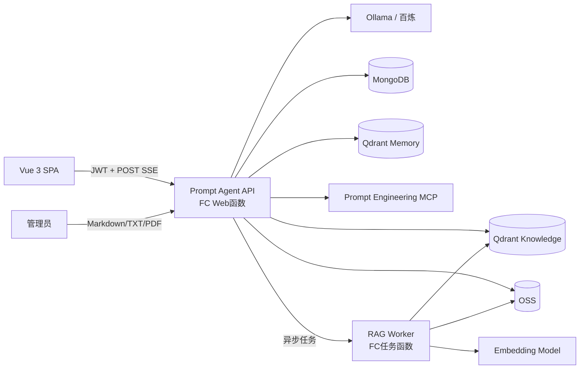
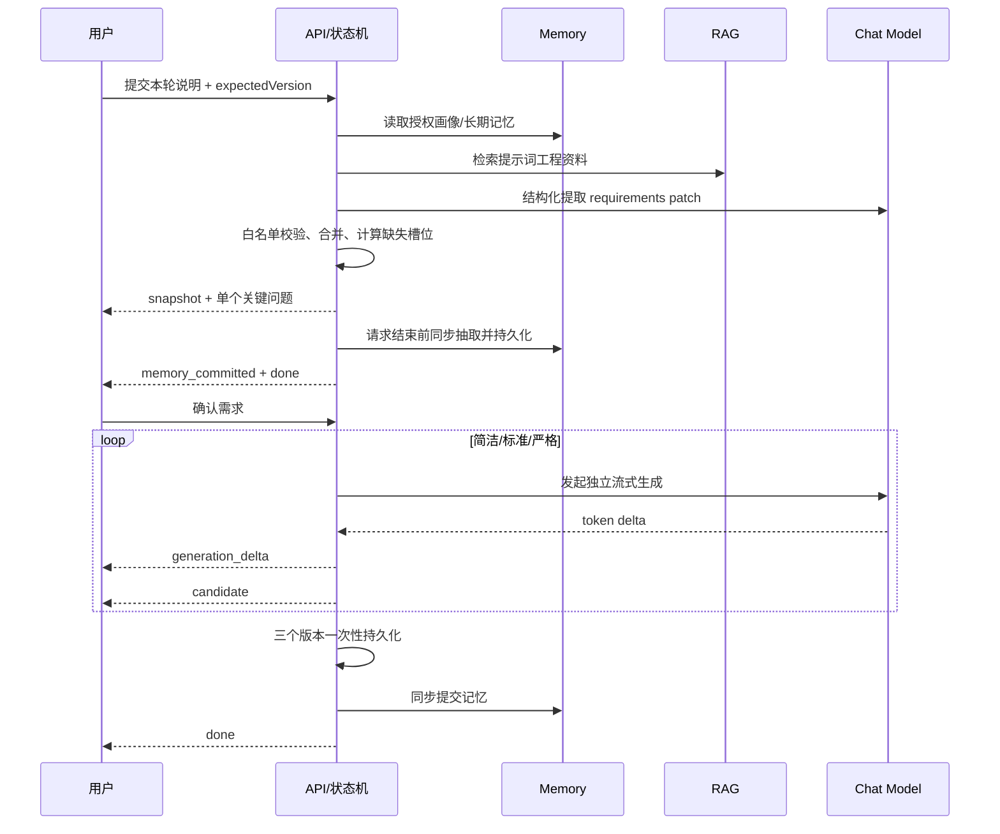
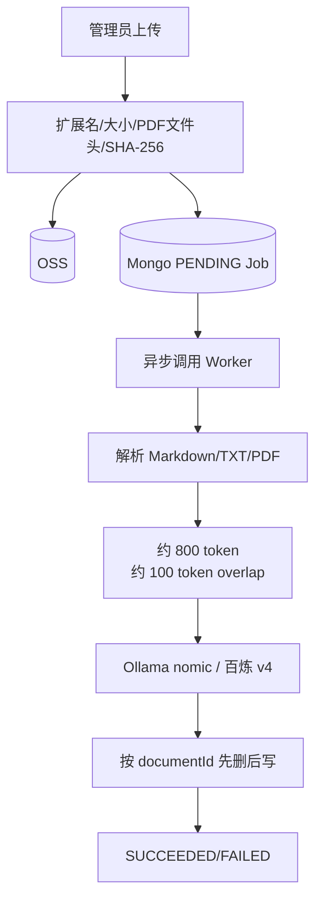

# 项目架构与开发思路

## 系统架构

前端部署到 OSS/CDN；API、MCP 和 RAG Worker 使用三个独立的函数计算自定义容器。函数实例不保存业务状态，账号、会话、任务和记忆元数据进入 MongoDB，语义向量进入 Qdrant，原始知识文档进入 OSS。MCP 函数启用 `MCP_SSE` 会话亲和；API 通过带 `X-MCP-Token` 的自定义 transport 连接。

## 提示词生成时序

核心流程不把自由对话直接当作状态。模型只产生一个候选 patch，Java 状态机负责字段白名单、完成条件、12 轮上限、版本冲突和状态跳转。模型 JSON 连续失败时，用用户原文填充当前最关键字段，保证小模型环境仍可推进。

确认后，三个候选使用独立流生成。每个候选最多尝试三次，客户端通过 `reset` 处理失败尝试；全部失败时使用确定性模板。只有三个候选全部就绪后才写入 MongoDB。客户端断开、发送失败或未捕获的模型异常会把状态恢复为 `AWAITING_CONFIRMATION`，允许安全重试。

## 需求模型

公共槽位为目标、背景、受众、输入、输出格式、约束、成功标准、语气和目标模型。任务类型额外要求：

- `CODE`：语言/框架、运行环境、验收测试。
- `ANALYSIS`：分析方法、证据标准。
- `IMAGE`：主体、风格、构图、画幅。
- `AGENT`：角色、允许工具、终止条件、安全边界。

用户可明确跳过字段。所有必填字段完成后进入确认态；达到 12 轮仍有缺项时，将缺项显示为假设，仍需用户确认，绝不静默生成。

## 记忆设计

短期对话保存在 `prompt_sessions.turns`。长期记忆采用导入的 memory starter：MongoDB 保存用户画像和 metadata index，Qdrant 保存语义记忆。应用传入 JWT 派生的 userId、sessionId 和显式 consent，禁止信任客户端 userId。

原 starter 在模型回复后通过线程池异步写入；函数计算可能在请求结束后冻结线程，因此 vendored 版本增加 `agent.memory.commit-mode=sync` 和 `rememberSynchronously`。SSE 必须在记忆写入完成或明确失败后才发送 `done`。

## RAG 设计

向量 metadata 包含 `kind`、`documentId`、`filename`、`checksum`、`version`、`chunkIndex`。本地和生产使用独立集合，embedding 模型更换时新建集合并重建索引，禁止混用向量空间。空知识库或检索异常时只跳过增强，不阻断核心对话。

## 工具与 MCP

内置工具只读或纯计算。网页读取拒绝非 HTTP(S)、回环/链路本地/私网/组播地址，禁止自动重定向并限制超时和正文大小。核心需求状态机不依赖模型是否支持 tool calling。

本地 `gemma3:1b` 不声明 Ollama tools 能力，因此默认不向模型请求附加工具 schema，避免模型调用直接失败；生产 `qwen-plus` 默认开启工具回调。该开关只控制模型是否主动调用工具，不会移除工具实现、MCP 服务或状态机能力。

MCP Server 提供 `listPromptFrameworks`、`getPromptFramework`、`lintPrompt`，资源 URI 为 `prompt://frameworks`，prompt 名为 `guided_prompt_generator`。本地可用 stdio，线上使用 SSE；公网入口必须置于私网、API Gateway 或令牌过滤之后。
