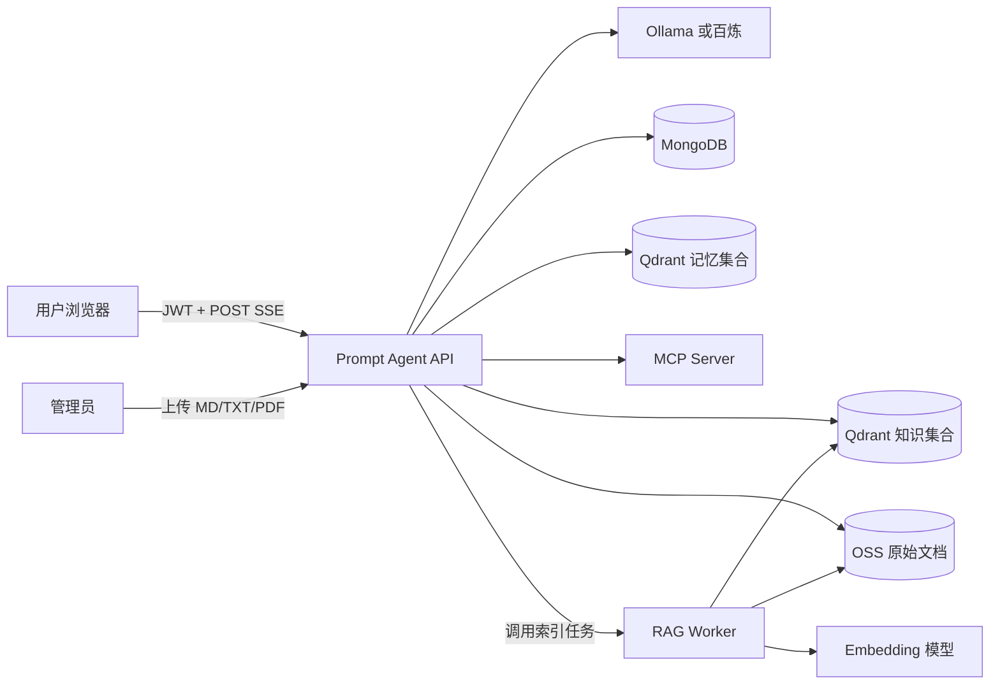
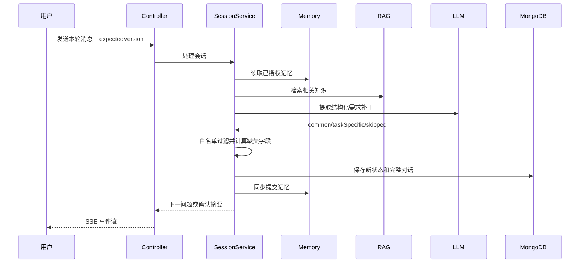
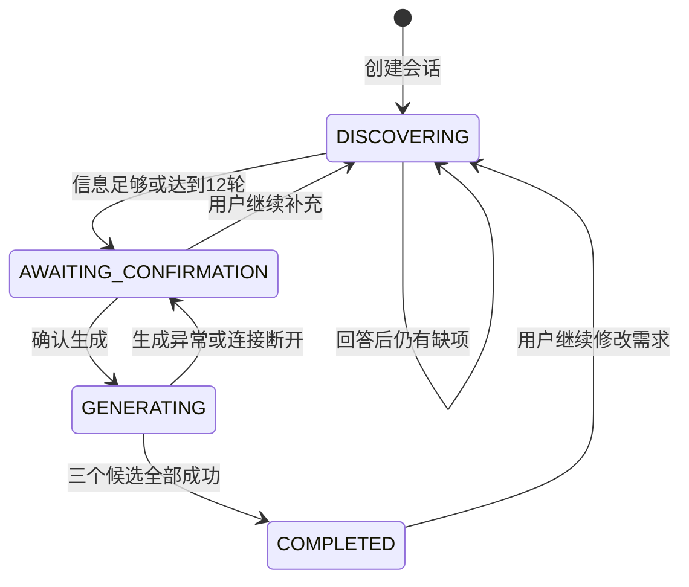
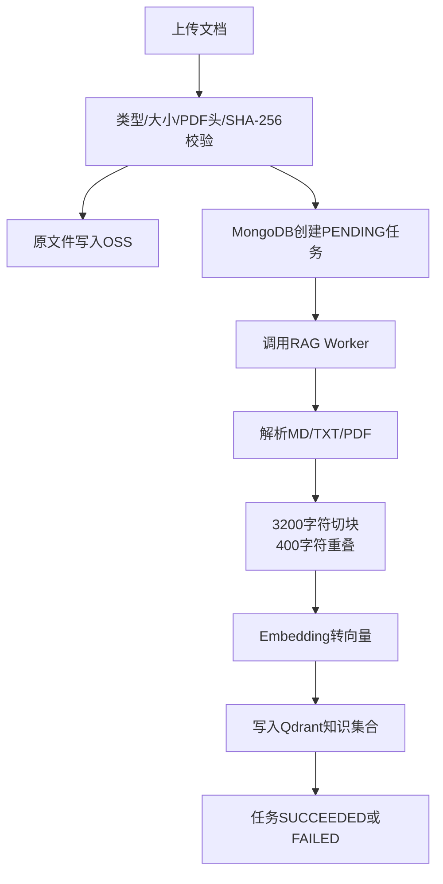

# Prompt Generator Agent：项目白话说明与面试手册

> 适用对象：希望看懂项目、维护项目，或准备 Java AI 应用开发面试的人。
>
> 这份文档只讲项目里真实存在的实现。没有使用的技术不会为了“听起来高级”而硬加进去。

## 1. 先用一句话说清项目

这是一个“提示词需求顾问”：它不会收到一句模糊要求后立刻生成提示词，而是像产品经理一样逐步追问目标、背景、输入、输出和限制，等用户确认后，再生成简洁版、标准版和严格版三个可直接使用的提示词。

### 1.1 面试时的 30 秒介绍

我做了一个提示词生成智能体。它用 Java 状态机控制多轮需求澄清，用 Spring AI 接入本地 Ollama 和生产百炼模型。系统还支持 MongoDB 会话、MongoDB 加 Qdrant 长期记忆、RAG 知识库、安全工具调用、MCP 客户端和服务端，以及 SSE 流式输出。部署上拆成 API、RAG Worker 和 MCP 三个容器，可以部署到阿里云函数计算。

### 1.2 面试时的 2 分钟介绍

这个项目解决的问题是：用户通常不知道怎样一次写出好提示词。如果直接把一句模糊描述交给模型，模型容易自行补全缺失条件，结果看起来完整，实际却不是用户真正需要的。

因此我没有让大模型独自控制流程。模型只负责从自然语言里提取结构化需求补丁，Java 代码负责字段白名单、缺失字段计算、会话状态、12 轮上限和并发版本检查。需求足够后，系统要求用户明确确认，再分别生成简洁、标准、严格三个版本，并通过 POST SSE 实时推送生成内容。

为了让结果更个性化，系统在用户授权后保存长期记忆；为了让模型参考可靠的提示词工程资料，系统支持 RAG；为了扩展能力，又接入了安全工具和 MCP。生产环境拆成无状态 API、异步 RAG Worker、MCP Server 三个函数容器，业务状态放在 MongoDB、Qdrant 和 OSS 中。

### 1.3 面试时的 5 分钟介绍顺序

按下面顺序讲，面试官比较容易听懂：

1. 先讲痛点：用户需求模糊，直接生成提示词不可靠。
2. 再讲核心方案：模型提取信息，Java 状态机决定下一步。
3. 接着讲主流程：逐轮追问、用户确认、三版本流式生成、选择和导出。
4. 再讲增强能力：记忆、RAG、安全工具和 MCP。
5. 最后讲工程化：JWT、乐观锁、失败降级、Docker、Serverless 和测试。

不要一上来背技术栈。先说解决了什么问题，再解释为什么用了这些技术。

## 2. 用户实际怎么使用

以“帮我生成一个 Java 接口开发提示词”为例：

1. 用户创建 `CODE` 类型会话。
2. 系统先问最终目标，例如要实现什么接口。
3. 用户回答后，大模型把自然语言转成结构化字段，例如 `goal`、`language`。
4. Java 状态机检查还缺什么，只选择一个最重要的问题继续问。
5. 信息足够或达到 12 轮上限后，系统展示需求摘要。
6. 用户点击“确认并生成”，系统才开始生成提示词。
7. 简洁版、标准版、严格版依次流式显示。
8. 用户选择一个候选，导出为 Markdown 或 JSON。

支持的任务类型有：

- `TEXT`：写作、改写、总结等文本任务。
- `CODE`：代码生成、修复、重构和测试。
- `ANALYSIS`：研究、比较、归纳和决策分析。
- `IMAGE`：图像生成提示词。
- `AGENT`：带角色、工具、终止条件和安全边界的智能体提示词。

## 3. 系统架构

每个组件最直白的解释：

| 组件 | 它在项目里干什么 |
| --- | --- |
| Vue 3 前端 | 显示对话、需求摘要、流式文本、候选提示词和知识库管理页。 |
| Prompt Agent API | 整个系统的“大脑和交通警察”，负责认证、状态判断、调用模型、RAG 和记忆。 |
| Ollama / 百炼 | 真正执行自然语言理解、提示词生成和向量计算的模型服务。 |
| MongoDB | 保存账号、刷新令牌摘要、会话、对话、候选、知识文档和索引任务。 |
| Qdrant | 保存向量，用“语义相似”而不是“文字完全相同”来找记忆和知识。 |
| OSS | 保存管理员上传的原始文档。数据库只保存元数据和 OSS 地址。 |
| RAG Worker | 从 OSS 取文档，解析、切块、向量化，再写入 Qdrant。 |
| MCP Server | 用标准协议对外提供提示词框架、提示词检查工具和引导式 prompt。 |
| 函数计算 FC | 运行三个无状态容器，根据请求量分配实例。 |

## 4. 模块怎么分

| 模块 | 主要职责 | 可以把它理解成 |
| --- | --- | --- |
| `prompt-agent-core` | 领域对象、Mongo Repository、需求状态机、提示词静态检查 | 不依赖 Web 的核心规则 |
| `prompt-agent-server` | HTTP API、JWT、Agent 编排、SSE、RAG 查询、记忆、工具 | 对外提供服务的主应用 |
| `prompt-agent-rag-worker` | 文档解析、切块、Embedding、Qdrant 入库 | 专门干重活的后台工人 |
| `prompt-engineering-mcp-server` | MCP tools、resource、prompt | 可被其他 AI 应用复用的能力服务 |
| `libs` | 导入并适配的 `spring-ai-agent-memory` 三个模块 | 可插拔的记忆组件 |
| `prompt-agent-frontend` | Vue 3 工作台和管理员页面 | 用户看得见的界面 |

这样拆分有两个主要好处：核心规则容易单元测试；文档索引不会占用聊天 API 的线程和超时时间。

## 5. 一次对话请求到底经历了什么

这里最关键的设计是：**大模型没有最终决定权。**

大模型擅长理解“用户这句话是什么意思”，但它的输出不稳定。因此它只返回一个候选补丁。Java 代码会做三件事：

1. 只接受当前任务类型允许的字段，模型多返回的字段直接丢弃。
2. 合并到已有 `RequirementProfile`，然后由确定性代码计算缺失字段。
3. 根据 `GuidedRequirementEngine` 的规则决定继续提问还是进入确认状态。

这样即使换模型、模型偶尔输出错误 JSON，整个业务流程仍然可控。

## 6. 会话状态机

四个状态分别表示：

- `DISCOVERING`：还在收集需求。
- `AWAITING_CONFIRMATION`：需求已经可以生成，但必须由用户确认。
- `GENERATING`：正在生成，拒绝同一会话的重复生成请求。
- `COMPLETED`：三个候选已经完整保存。

达到 12 轮不是直接偷偷生成。系统会把剩余缺项标记为假设，仍然要求用户确认。

## 7. 提示词生成为什么有三个版本

- 简洁版：内容短，适合一次性、低风险任务。
- 标准版：角色、步骤、限制、格式和检查比较平衡，适合大部分场景。
- 严格版：边界和验收标准最明确，适合自动化、团队复用和高稳定性要求。

每个版本最多调用模型三次。一次失败后，服务端发送 `reset=true`，前端清空这次尝试已经显示的半截内容。如果三次都失败，系统使用 Java 的确定性模板生成保底版本。

三个候选全部完成后才一起写入 MongoDB。这相当于“要么保存完整结果，要么不保存半成品”。它不是数据库分布式事务，但实现了业务层面的原子提交效果。

## 8. 为什么使用 POST SSE

普通 HTTP 要等模型全部生成完才能返回，用户会长时间看到空白。SSE 可以让服务端每得到一小段模型输出就推给浏览器。

原生 `EventSource` 只能方便地发 GET，而且不适合携带本项目需要的 JSON 请求体和 Authorization Header，所以前端使用 `fetch` 发 POST，再自己解析 `text/event-stream`。

主要事件包括：

- `snapshot`：当前结构化需求。
- `question` / `confirmation_required`：下一个问题或确认通知。
- `generation_started`：开始生成。
- `generation_delta`：某个候选的新文本片段。
- `candidate` / `candidates`：单个或全部候选完成。
- `knowledge_sources`：本次用到了哪些知识文档。
- `memory_committed`：长期记忆是否提交成功。
- `done`：本次请求最终完成。
- `error`：可展示给用户的错误。

当前 SSE 没有实现 `Last-Event-ID` 和断点续传。连接断开后，生成状态会回到可确认状态，用户可以安全重试。

## 9. Spring AI 在项目里做了什么

Spring AI 可以理解成“Java 世界里连接不同 AI 模型的统一插座”。项目主要用了这些抽象：

- `ChatModel`：统一聊天模型接口。
- `ChatClient`：组织 system/user 消息，执行普通或流式调用。
- `EmbeddingModel`：把文字转成向量。
- `VectorStore`：统一 Qdrant 的添加、删除和相似度检索。
- `ToolCallback`：把 Java 方法描述给支持工具调用的模型。
- MCP Client/Server：连接外部工具和对外提供标准 AI 能力。

本地通过 Spring Profile 选择 Ollama，生产通过 `prod` Profile 选择百炼。业务代码依赖的是 `primaryChatModel` 和 `primaryEmbeddingModel`，所以业务服务不需要知道当前到底是哪家模型。

本地模型是 `gemma3:1b`。它体积小、方便学习，但 Ollama 清单不声明原生 tools 能力，因此本地默认关闭模型主动工具调用。需求状态机、RAG 和生成能力仍然可以工作。生产默认使用 `qwen-plus`，Embedding 默认使用 `text-embedding-v4`。

## 10. 记忆系统

### 10.1 短期记忆

短期记忆就是当前会话里的完整 `turns`。它和结构化需求一起保存在 MongoDB 的 `prompt_sessions` 文档中，刷新页面后可以恢复。

### 10.2 长期记忆

长期记忆保存跨会话仍有价值的信息，例如用户偏好的输出风格、常用技术栈和稳定约束。

- MongoDB 保存用户画像和可分页查询的记忆元数据索引。
- Qdrant 保存长期记忆向量，用语义相似度召回。
- `AgentMemoryService` 负责准备上下文和提取新记忆。
- `AgentMemoryManager` 提供查看、导出、禁用和删除能力。

只有用户明确授权 `memoryConsent=true` 才会使用长期记忆。服务端从 JWT 获取 userId，不接受客户端随便传一个 userId，避免读取别人的记忆。

### 10.3 为什么改成同步提交

原记忆组件可以在线程池里异步保存。但函数计算在请求结束后可能冻结实例，后台线程不一定有机会完成。项目因此增加同步提交模式，先完成记忆写入或明确记录失败，再发送 SSE 的 `done`。

代价是请求尾部会多一点延迟；好处是用户看到“完成”时，记忆结果已经确定。

## 11. RAG 知识库

RAG 的全称是 Retrieval-Augmented Generation，直白地说就是：**先从自己的资料里找相关内容，再让模型带着这些资料回答。**

为什么要切块？整本文件太长，直接送给模型贵且不精准。项目每块最多 3200 个字符，相邻块重叠 400 个字符，尽量避免一句话刚好被切断后失去上下文。

每块都带有 `documentId`、文件名、校验和、版本和块序号。块 ID 根据文档 ID、版本和序号稳定生成。重新索引时先按 `documentId` 删除旧向量，再写入新向量，从而避免重复数据。

知识库为空或检索失败时，聊天流程继续运行，只是这一次没有知识增强。这叫“可降级”，因为 RAG 是增强能力，不应该成为核心功能的单点故障。

## 12. MCP 和工具调用

工具调用是模型根据工具描述，决定调用某个 Java 方法。项目提供时间、计算、搜索、受限网页读取和提示词检查工具。

MCP 可以理解成“AI 工具的 USB 标准”：只要客户端和服务端都遵守协议，就不需要为每个 AI 应用单独写一套私有接口。

本项目的 MCP Server 提供：

- Tools：`listPromptFrameworks`、`getPromptFramework`、`lintPrompt`。
- Resource：`prompt://frameworks`。
- Prompt：`guided_prompt_generator`。
- 传输方式：本地可用 stdio，线上使用 SSE。

MCP 入口可以要求 `X-MCP-Token`。API 的自定义 transport 会在握手和后续消息请求中携带这个令牌。

工具不是越多越好。任意 Shell、任意文件写入和无限制网页访问都没有提供。网页读取会拦截回环、私网、链路本地和组播地址，同时限制重定向、超时和正文大小，重点防止 SSRF。

## 13. 数据为什么这样存

| 数据 | 存储 | 原因 |
| --- | --- | --- |
| 用户、刷新令牌摘要、会话、对话、候选 | MongoDB | 结构会演进，会话整体读取多，文档模型比较自然。 |
| 知识文档和索引任务元数据 | MongoDB | 需要明确状态、错误、版本和管理查询。 |
| 用户长期记忆向量 | Qdrant memory 集合 | 需要按语义相似度召回。 |
| RAG 知识块向量 | Qdrant knowledge 集合 | 需要语义检索，并与记忆数据隔离。 |
| 上传的原始文件 | OSS | 适合保存大文件，价格低，也方便 Worker 读取。 |

Embedding 模型决定向量维度和向量空间。同一句话经过不同模型生成的向量不能直接混用。因此本地和生产使用不同集合；更换 Embedding 模型时要创建新集合并重建索引。

## 14. 认证、安全和并发

### 14.1 JWT 和 Refresh Token

- Access Token 有效期默认 15 分钟，用于访问业务 API。
- Refresh Token 有效期默认 7 天，放在 HttpOnly Cookie 中。
- 服务端只保存 Refresh Token 的 SHA-256 摘要，不保存原文。
- 每次刷新都会撤销旧 token 并发放新 token，减少 token 被复制后的长期风险。
- 普通用户只能访问自己的会话；管理员接口要求 `ADMIN` 角色。

### 14.2 乐观锁

`PromptSession.version` 使用 MongoDB 的 `@Version`。前端提交 `expectedVersion`，如果数据库版本已经变化，服务端返回 409，要求刷新后重试。

它解决的是两个浏览器标签页、重复点击或并发请求同时修改一个会话的问题。这里不适合长时间加悲观锁，因为一次模型调用可能很慢，会让锁长期占用。

### 14.3 提示词注入

RAG 文档和外部网页都被当作“不可信数据”。system 消息明确要求模型不得执行资料里的指令。更重要的是，模型提取结果还要经过 Java 字段白名单过滤，降低外部文本改变业务状态的机会。

这不能保证完全消除模型层攻击，所以生产上还应增加内容审查、模型调用审计和更细的工具授权。

## 15. 设计模式如何落到代码

### 15.1 分层架构

Controller 只处理 HTTP 和 SSE，Service 编排业务，Repository 负责数据库，领域对象保存业务状态。这样测试业务时不必真的启动浏览器和 HTTP 服务。

### 15.2 Repository 模式

`PromptSessionRepository`、`AppUserRepository` 等把 MongoDB 查询封装成接口。业务服务表达“找这个用户的会话”，不用自己拼 Mongo 查询。

### 15.3 Strategy 策略模式

`ModelConfig` 根据 Spring Profile 注入 Ollama 或百炼的 `ChatModel`/`EmbeddingModel`。业务代码只面向统一接口，这就是“同一个目标有多种可替换实现”。

记忆系统里的 `UserProfileStore`、`LongTermMemoryStore` 也体现了同样思路，可以使用内存、MongoDB 或 Qdrant 实现。

### 15.4 Adapter 适配器模式

`ObjectStorage` 把 OSS SDK 转换成项目自己的 `put/get/delete/available` 接口；MCP transport 把 Spring AI MCP 客户端需要的调用转换成带令牌的 HTTP SSE 请求。外部 SDK 改动时，业务代码受到的影响更小。

### 15.5 Gateway / Facade

`PromptModelGateway` 集中处理 ChatClient、结构化提取、工具回调、流式生成、重试、提示词检查和保底模板。其他业务服务不需要重复了解模型调用细节。

### 15.6 Observer / Callback

`GenerationListener` 接收生成增量和候选完成事件。模型网关只负责“产生事件”，Controller 决定把事件转换成什么 SSE 帧，二者不直接绑死。

### 15.7 Null Object

`GenerationListener.noop()` 提供一个什么也不做的监听器，调用方不需要到处写 `if (listener != null)`。记忆模块的 `UnavailableLongTermMemoryIndex` 也让未配置索引时仍能通过统一接口表达“此能力不可用”。

### 15.8 依赖注入和工厂配置

Spring 容器负责创建模型、向量库、存储、工具和 Service。`@Configuration` 加 `@Bean` 相当于集中组装对象，业务类通过构造器接收依赖，便于替换和测试。

### 15.9 显式状态机

项目使用枚举加规则代码实现状态机，而不是为每个状态创建一个 GoF State 类。状态不多时这种写法更直接。以后状态和转移大量增加，再考虑 Spring Statemachine 或状态对象。

### 15.10 工程模式但不是 GoF 模式

乐观锁、幂等索引、重试、降级、业务原子提交和同步记忆提交都是重要工程策略，但不要在面试时把它们硬说成 GoF 设计模式。

## 16. Serverless 部署思路

生产环境拆成三个函数容器：

- API：300 秒超时，处理登录、会话、SSE 和管理接口。
- MCP：SSE 服务，配置会话亲和，避免同一 MCP 会话落到不同实例。
- RAG Worker：900 秒超时，低并发处理文档解析和向量化。

函数容器本身不保存业务状态。实例随时可能销毁，所以数据必须进入 MongoDB、Qdrant 或 OSS，记忆不能依赖请求结束后的后台线程。

API 是 Qdrant 集合的 schema 初始化方，Worker 只使用已经存在的知识集合，避免两个冷启动实例同时建表产生竞争。

`deploy/s.yaml` 只描述函数，不会自动创建 MongoDB、Qdrant、OSS、ACR、密钥和网络。这些生产资源要提前准备。当前项目已经验证部署模板和镜像，但没有使用真实云账号发布。

## 17. 项目的亮点、限制和下一步

### 17.1 可以重点讲的亮点

- 用确定性状态机约束不确定的大模型。
- 多模型切换不侵入核心业务。
- 三版本真实流式生成，并正确处理重试时的前端文本重置。
- 记忆有显式授权、导出和删除能力。
- RAG Worker 与聊天 API 隔离，失败时核心流程可降级。
- 工具和 MCP 有明确安全边界。
- 使用乐观锁防止重复生成和并发覆盖。
- 从本地 Ollama 到函数计算有完整环境配置和容器方案。

### 17.2 要诚实说明的限制

- `gemma3:1b` 能力有限，而且不支持原生 tools。
- RAG Worker 通过 HTTP/FC 异步调用，不是 Kafka、RabbitMQ 这样的消息队列。
- 重建文档向量采用先删后写，写入失败时可能出现短暂空窗。
- SSE 没有跨实例断点续传。
- 当前没有分布式限流、统一链路追踪和自动化云资源创建。
- 已有 Serverless 配置不等于已经在真实生产环境发布。

### 17.3 可以继续优化

- 引入 Outbox 加消息队列，增强 RAG 任务可靠投递。
- 使用新版本集合加别名切换，避免重建索引的空窗。
- 为模型调用增加超时、指标、成本统计和熔断策略。
- 增加 SSE 事件持久化或任务查询接口，实现断线恢复。
- 引入 API Gateway/WAF 限流、审计和内容安全。
- 增加 Testcontainers、端到端浏览器测试和线上质量评估集。

## 18. 本地启动和排错顺序

推荐顺序：

1. 启动 Docker Desktop。
2. 启动 MongoDB 和 Qdrant：`docker compose up -d`。
3. 准备模型：`ollama pull gemma3:1b`、`ollama pull nomic-embed-text`。
4. 启动 API，等待 `/api/actuator/health` 正常。
5. 启动 RAG Worker 和 MCP Server。
6. 在项目根目录执行 `npm --prefix prompt-agent-frontend ci`、`npm --prefix prompt-agent-frontend run dev`。
7. 浏览器访问 `http://localhost:5173`。

常见问题：

| 现象 | 优先检查 |
| --- | --- |
| API 启动失败 | MongoDB、Qdrant 端口以及 Java 21。 |
| 模型调用失败 | Ollama 是否运行、模型名是否存在、base URL 是否正确。 |
| 本地工具调用报错 | `gemma3:1b` 不支持 tools，本地开关应保持关闭。 |
| 上传返回 503 | 本地没有配置 OSS，这是预期行为。 |
| SSE 一直没有内容 | 浏览器是否用 Fetch Streams、JWT 是否过期、代理是否缓冲响应。 |
| 返回 409 | 会话版本冲突，重新加载最新会话再提交。 |
| RAG 没有召回 | Worker 任务状态、Embedding 模型、Qdrant 集合和相似度阈值。 |
| MCP 返回 401 | API 和 MCP Server 的 token 是否完全一致。 |

## 19. 面试问题与参考答案

下面的回答可以直接用于表达，但最好结合自己的开发过程改成自然口吻。

### 一、项目整体

### 1. 这个项目解决了什么问题？

**直接回答：** 很多用户只会给出一句模糊需求，直接让模型生成提示词容易遗漏输入、限制和验收标准。项目通过逐轮追问把模糊需求变成结构化需求，确认后再生成三种强度的提示词。

**继续追问：** 核心价值不是“再调用一次大模型”，而是把需求澄清流程产品化，并用确定性规则约束模型的不稳定性。

### 2. 这个项目和普通聊天机器人有什么不同？

**直接回答：** 普通聊天机器人主要输出下一句话；这个项目有明确的业务状态、字段完成条件、确认动作、候选保存和导出结果。对话只是输入形式，真正驱动流程的是结构化状态。

**继续追问：** 即使模型说“可以生成了”，Java 状态机判断字段不够，系统仍会继续追问。

### 3. 为什么不让模型自己决定下一步？

**直接回答：** 模型输出具有随机性，可能漏字段、跳步骤或被外部文本影响。项目让模型负责理解语言，让 Java 负责业务决策，可以测试、复现和审计。

**继续追问：** 模型返回的字段还要经过任务类型白名单过滤，不能直接修改任意会话状态。

### 4. 为什么生成三个版本？

**直接回答：** 不同场景需要的约束程度不同。简洁版适合快速任务，标准版适合日常复用，严格版适合自动化和高稳定性任务，让用户按成本和可靠性选择。

**继续追问：** 三个版本不是简单改温度，而是使用不同的生成要求，并各自独立重试和校验。

### 5. 你在项目中最重要的设计是什么？

**直接回答：** 我认为是“LLM 提取补丁，Java 状态机做最终决定”。它把 AI 的语言理解能力和传统软件的确定性结合起来。

**继续追问：** 第二个重点是失败处理，包括小模型 JSON 失败降级、生成重试、SSE reset 和不保存半成品。

### 6. 你如何证明项目不是一个 Demo？

**直接回答：** 项目不仅能调模型，还包含身份认证、权限、持久化、并发控制、RAG 任务、记忆隐私、MCP、安全工具、容器和 Serverless 配置，并有 35 项后端测试、前端测试和实际协议联调。

**继续追问：** 同时我会诚实说明还没有真实生产发布，也没有消息队列和分布式 SSE 恢复。

### 二、Java 与 Spring

### 7. 为什么使用 Java 21 和 Spring Boot？

**直接回答：** Java 适合写规则明确、长期维护的服务，Spring Boot 提供 Web、安全、配置、数据访问和依赖注入。Java 21 是当前 LTS，项目也使用 record、现代 switch 等特性减少样板代码。

**继续追问：** 生产镜像固定 Java 21，避免开发机更高版本和 Byte Buddy 等测试依赖不兼容。

### 8. Spring AI 的价值是什么？

**直接回答：** 它给 ChatModel、EmbeddingModel、VectorStore、ToolCallback 和 MCP 提供统一抽象，减少直接绑定某家模型 SDK。

**继续追问：** 它不能替代业务设计。状态机、重试、权限和数据一致性仍然由项目自己实现。

### 9. 项目如何切换 Ollama 和百炼？

**直接回答：** `ModelConfig` 根据 Spring Profile 注入不同实现，并统一命名为 `primaryChatModel` 和 `primaryEmbeddingModel`。业务类只依赖统一接口。

**继续追问：** 本地 Profile 使用 Ollama，`prod` 使用 DashScope；模型名和地址通过环境变量配置。

### 10. 为什么使用构造器注入？

**直接回答：** 依赖在对象创建时就完整，字段可以保持不可变，也方便单元测试传入 mock。相比字段注入，依赖关系更清晰。

**继续追问：** 多个相同类型 Bean 用 `@Qualifier` 明确区分，例如两个 VectorStore 集合。

### 11. Controller、Service、Repository 如何分工？

**直接回答：** Controller 处理协议和参数，Service 编排业务规则，Repository 负责持久化。这样模型调用和状态判断不会散落在 HTTP 层。

**继续追问：** `PromptSessionController` 负责把回调变成 SSE，`PromptSessionService` 负责状态和事务边界，Repository 只表达查询。

### 12. 为什么用 MongoDB 而不是 MySQL？

**直接回答：** 会话包含结构化需求、完整 turns 和候选列表，整体读写较多，字段也可能随任务类型演进，文档模型比较自然。

**继续追问：** 这不是说 MySQL 做不了。若需要复杂关联报表和强关系约束，MySQL 可能更合适。

### 13. Spring Profile 和普通配置开关有什么区别？

**直接回答：** Profile 更适合整套环境 Bean 的切换，例如本地模型和生产模型；普通开关适合控制单项能力，例如是否把工具 callback 附加给模型。

**继续追问：** 项目同时使用二者，因为生产模型切换和 tool 支持能力是两个不同维度。

### 三、Agent 与提示词

### 14. 这个项目算 Agent 吗？

**直接回答：** 它是一个受控工作流型 Agent：能感知用户输入和上下文，维护状态，选择下一问题，调用模型、知识、记忆和工具，并在满足终止条件时输出结果。

**继续追问：** 它不是完全自主的开放式 Agent，因为关键状态转移由 Java 规则控制，这正是项目为了可靠性做的选择。

### 15. system、user、assistant 消息分别是什么？

**直接回答：** system 定义模型必须遵守的角色和规则，user 是用户本轮输入，assistant 是模型历史回复。多轮对话通过有序消息让模型理解上下文。

**继续追问：** 本项目不会只依赖聊天历史，还把需求整理成 `RequirementProfile`，避免历史越来越长且难以判断完成条件。

### 16. 如何处理模型返回错误 JSON？

**直接回答：** 结构化提取最多重试三次，每次失败会强化“严格返回 JSON”的要求。如果仍失败，就把用户原文放入当前关键字段，保证小模型环境能继续推进。

**继续追问：** 即使 JSON 可以解析，也要做字段白名单和非空校验，解析成功不等于业务合法。

### 17. 为什么设置 12 轮上限？

**直接回答：** 防止用户和系统无限追问，控制时间、模型成本和体验。达到上限后展示缺失项为假设，让用户最终确认。

**继续追问：** 上限不是强制生成，确认权仍在用户手里。

### 18. Prompt lint 检查什么？

**直接回答：** 它做确定性的结构检查，例如是否包含目标、输入占位符、输出要求和质量标准，给候选附上警告或检查项。

**继续追问：** lint 不是判断内容绝对正确，而是低成本发现明显结构缺失。

### 19. 如何防止 RAG 文档中的提示词注入？

**直接回答：** 文档被标记为不可信参考，system 指令明确禁止执行文档指令；结构化提取结果还会经过 Java 白名单。

**继续追问：** 模型防护不是数学上的完全隔离，高风险场景还要限制工具权限、记录调用和增加内容审核。

### 20. 为什么生成失败后还需要 Java 保底模板？

**直接回答：** 模型服务可能超时、限流或返回空内容。如果完全依赖模型，用户可能追问十几轮后什么也得不到。保底模板保证系统至少返回结构完整、可编辑的结果。

**继续追问：** 保底结果会使用已确认需求，不会凭空编造新的业务事实。

### 21. 如何评估生成提示词的质量？

**直接回答：** 当前使用字段完整性、输出格式、约束和静态 lint 做基础检查。更完善的方案是准备真实任务数据集，比较执行结果的正确率、格式通过率和人工偏好。

**继续追问：** 不能只让同一个模型给自己的输出打分，应结合规则、人工和下游任务结果。

### 四、RAG

### 22. RAG 和模型微调有什么区别？

**直接回答：** RAG 在运行时检索外部资料，不改变模型参数，资料更新快且可显示来源；微调改变模型行为，更适合固定风格或任务能力。

**继续追问：** 提示词工程资料会持续更新，所以这个项目优先使用 RAG。

### 23. RAG 的完整流程是什么？

**直接回答：** 上传文档、校验、保存 OSS、创建任务、Worker 解析、切块、Embedding、写 Qdrant；查询时把用户问题向量化，找相似块，再放进模型上下文。

**继续追问：** 文档状态和任务状态在 MongoDB 中，便于管理端查看失败原因和重试。

### 24. 为什么文档要切块并重叠？

**直接回答：** 整篇文档太长且检索不精确。切块让召回定位到相关段落，重叠可以减少句子或概念被边界截断的问题。

**继续追问：** 当前是 3200 字符、400 字符重叠，是工程初始值，生产中应根据文档类型和评估集调优。

### 25. 什么是 Embedding？

**直接回答：** Embedding 把一段文字变成一组数字。意思接近的文字在向量空间里距离更近，所以可以做语义检索。

**继续追问：** 不同 Embedding 模型的维度和空间不同，不能把它们的向量混在一个集合里比较。

### 26. 为什么选择 Qdrant？

**直接回答：** Qdrant 专门做向量存储和相似度检索，支持 metadata 过滤，Spring AI 也有成熟适配。本项目需要按 `kind`、`documentId` 等过滤。

**继续追问：** 选择向量库还应考虑数据量、运维、备份、延迟和团队经验，不是所有项目都必须用 Qdrant。

### 27. 如何避免同一文档重复入库？

**直接回答：** 上传时计算 SHA-256，识别重复文件；块 ID 根据文档 ID、版本和序号稳定生成；重建时先按 documentId 删除旧向量再写新向量。

**继续追问：** 当前先删后写有短暂空窗，更强方案是写入新版本集合后再切别名。

### 28. RAG 服务失败会怎样？

**直接回答：** 查询失败时记录日志并返回空上下文，提示词主流程继续；索引失败时任务进入 FAILED 并保存错误，管理员可以重试。

**继续追问：** 这是把增强能力与核心能力隔离，避免 Qdrant 或 Worker 故障拖垮所有聊天。

### 五、记忆

### 29. 会话历史和长期记忆有什么区别？

**直接回答：** 会话历史只描述这次对话，长期记忆保存跨会话仍有价值的稳定偏好。两者生命周期和隐私要求不同。

**继续追问：** 不是所有对话都应该进入长期记忆，组件会做提取、路由和敏感信息过滤。

### 30. 为什么记忆同时使用 MongoDB 和 Qdrant？

**直接回答：** MongoDB 适合保存画像、元数据、分页和精确管理；Qdrant 适合按语义找相关记忆。一个负责管理事实，一个负责相似召回。

**继续追问：** 删除记忆时两个存储都要清理，避免出现向量残留。

### 31. 如何保护用户记忆隐私？

**直接回答：** 必须显式授权，userId 从 JWT 推导，提供查看、导出、关闭和删除接口，并启用敏感信息过滤。

**继续追问：** 生产还应补充加密、保留期限、审计和合规策略。

### 32. 为什么 Serverless 下使用同步记忆提交？

**直接回答：** 请求结束后函数实例可能被冻结，异步线程不保证继续执行。同步提交让 `done` 到达时记忆结果已经确定。

**继续追问：** 代价是增加尾延迟，也可以改成可靠消息队列加幂等消费者。

### 33. 记忆服务失败会阻断生成吗？

**直接回答：** 不会。准备或提交记忆失败会记录日志并返回 `memory_committed=false`，主流程仍然完成。

**继续追问：** 这是有意的降级设计，因为记忆是个性化增强，不是生成提示词的硬依赖。

### 六、MCP 与工具

### 34. MCP 是什么？

**直接回答：** MCP 是模型上下文协议，用统一方式让 AI 客户端发现和调用工具、读取资源、获取 prompt。可以把它理解为 AI 能力的标准接口。

**继续追问：** 本项目同时实现 MCP 客户端和服务端，证明能力既能被主 Agent 使用，也能提供给其他客户端。

### 35. MCP 的 tool、resource、prompt 有什么区别？

**直接回答：** tool 是可以执行的函数；resource 是可读取的数据；prompt 是可复用的消息模板。

**继续追问：** 项目用 tool 查询和检查框架，用 resource 暴露框架目录，用 prompt 提供引导式生成模板。

### 36. 为什么 MCP SSE 需要会话亲和？

**直接回答：** SSE 建立的是长连接，后续消息要回到保存该会话状态的实例。函数计算如果把请求分到另一实例，协议会话可能丢失。

**继续追问：** `sessionAffinity=MCP_SSE` 用于让同一会话尽量命中同一个实例。

### 37. 为什么本地关闭 Tool Calling？

**直接回答：** 当前 `gemma3:1b` 的 Ollama 模型清单不支持 tools，附加工具 schema 会直接失败，所以用配置开关关闭。

**继续追问：** 关闭的是“模型主动调用工具”，不是删除工具、MCP、状态机或 RAG 能力。

### 38. 如何保证工具调用安全？

**直接回答：** 只提供白名单的只读或纯计算工具，不提供任意 Shell 和文件写入。网页工具限制协议、IP 范围、重定向、超时和内容大小。

**继续追问：** 生产环境还应按用户、工具和参数做授权，并记录每次调用审计日志。

### 七、安全、SSE 与并发

### 39. Access Token 和 Refresh Token 为什么分开？

**直接回答：** Access Token 短期、频繁使用；Refresh Token 长期、只用于换新 Access Token。这样 Access Token 泄漏后的有效窗口较短。

**继续追问：** Refresh Token 使用 HttpOnly Cookie、服务端摘要和轮换撤销，降低脚本读取和重放风险。

### 40. 为什么 Refresh Token 只保存摘要？

**直接回答：** 如果数据库泄漏，攻击者不能直接拿保存值调用刷新接口。服务端收到原 token 后计算 SHA-256 再查询。

**继续追问：** 这类似密码只保存哈希，但高熵随机 token 不一定需要 BCrypt 的慢哈希成本。

### 41. 为什么使用乐观锁？

**直接回答：** 模型调用时间长，不适合一直占用悲观锁。乐观锁允许正常并发读取，只在保存时发现版本冲突并返回 409。

**继续追问：** 前端的 `expectedVersion` 提前发现旧页面提交，MongoDB `@Version` 防止最终写入覆盖。

### 42. POST SSE 和 WebSocket 怎么选？

**直接回答：** 本项目主要是服务端单向推送生成文本，SSE 更简单，也沿用 HTTP 语义。WebSocket 更适合高频双向通信。

**继续追问：** 因为需要 POST body 和 Authorization Header，前端用 Fetch Streams 而不是原生 EventSource。

### 43. 客户端在生成中断线怎么办？

**直接回答：** 服务端捕获发送失败，把会话从 GENERATING 恢复到 AWAITING_CONFIRMATION，不保存不完整候选，用户可以重新确认生成。

**继续追问：** 当前不是断点续传；要实现续传，需要把生成任务和事件持久化并支持按事件序号补发。

### 44. 如何防止用户读取别人的会话？

**直接回答：** 查询不是只按会话 ID，而是按 `id + userId`。userId 来自校验后的 JWT，查不到统一返回不存在。

**继续追问：** 管理员知识接口另用 RBAC 限制，Worker 和 MCP 内部接口使用独立 token。

### 八、Serverless 与工程化

### 45. 为什么把 RAG Worker 单独拆出来？

**直接回答：** 文档解析和 Embedding 耗时、耗内存，和聊天 API 的延迟目标不同。拆开后可以设置更长超时、更低并发，也不会占住聊天实例。

**继续追问：** 当前 API 通过 HTTP 或 FC 异步调用 Worker；更高可靠性可以引入消息队列和 Outbox。

### 46. Serverless 最大的设计影响是什么？

**直接回答：** 实例不可靠且可能随时销毁，所以不能把业务状态放在本地内存或依赖请求结束后的线程，必须外置到 MongoDB、Qdrant、OSS。

**继续追问：** 还要考虑冷启动、长连接、超时、会话亲和和数据库连接数。

### 47. 项目如何发布和回滚？

**直接回答：** 构建三个 AMD64 镜像推送 ACR，用 Serverless Devs 部署测试函数，冒烟通过后发布版本并通过别名灰度。回滚时把别名切回上一版本。

**继续追问：** Qdrant 集合使用版本化命名，避免应用回滚却读取不兼容的新向量空间。

### 48. 如果让你继续完善项目，优先做什么？

**直接回答：** 我会先建立真实提示词评估集和可观测性，因为没有质量指标就不知道优化是否有效；然后补可靠任务队列、RAG 无空窗重建和 SSE 断线恢复。

**继续追问：** 安全上再增加 Gateway 限流、调用审计、内容安全和密钥托管，最后才是增加更多模型或工具。

## 20. 面试表达提醒

- 先说业务问题，再说技术方案。
- 每个技术都要能回答“为什么用”和“不用会怎样”。
- 主动说出一个限制和改进方案，比把项目包装成万能系统更可信。
- 不要说“用了状态机所以绝对不会错”，应说“状态转移可测试、可控，降低模型不确定性”。
- 不要说“使用 RAG 就不会幻觉”，应说“RAG 提供可检索资料并降低无依据回答，仍需来源、阈值和评估”。
- 不要说“已经部署生产”，当前准确表述是“完成 Serverless 配置、镜像和模板验证，尚未使用真实云资源发布”。

## 21. 参考资料

- 项目 `README.md`、`docs/architecture.md`、`docs/api.md`、`docs/deployment.md`。
- DAIR.AI Prompt Engineering Guide：[ChatGPT 提示工程](https://www.promptingguide.ai/zh/models/chatgpt)。本文只吸收其关于消息角色和多轮对话的基础思路，项目实现以当前源码为准。
