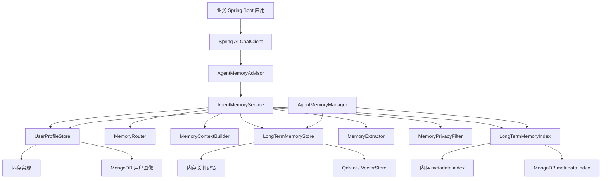

# Spring AI Agent Memory

[](https://github.com/MrWangjizhen/spring-ai-agent-memory/actions/workflows/ci.yml)
[](LICENSE)
[](https://openjdk.org/projects/jdk/21/)
[](https://spring.io/projects/spring-ai)

Spring AI Agent Memory 是一个可插拔的 Agent 记忆 starter，目标是把用户画像、短期记忆、长期记忆、记忆路由、记忆抽取、隐私过滤和可观测性封装成独立模块，让业务 Agent 通过 `Advisor` 非侵入式接入记忆能力。

当前项目是实验性的独立工程，不依赖任何具体业务应用。建议在生产接入前先评估隐私、审计、一致性和存储运维边界。

## 模块

- `agent-memory-core`：核心 API、领域模型、默认内存实现、`AgentMemoryAdvisor`、画像合并、隐私过滤、上下文构建和管理服务。
- `agent-memory-spring-boot-autoconfigure`：Spring Boot 自动装配、配置绑定、MongoDB 用户画像适配器、Qdrant 长期记忆适配器。
- `agent-memory-spring-boot-starter`：业务项目引入的 starter 入口，不强制传递 MongoDB 或 Qdrant。

## 架构



请求前链路：

- `AgentMemoryAdvisor` 从请求参数中读取用户、会话和授权信息。
- `AgentMemoryService` 加载用户画像，调用 `MemoryRouter` 判断是否需要检索长期记忆。
- 如需检索，`LongTermMemoryStore.search` 从内存或向量库召回相关长期记忆。
- `MemoryContextBuilder` 将用户画像和长期记忆组装为 prompt 上下文。

响应后链路：

- `AgentMemoryService` 异步调用 `MemoryExtractor` 抽取画像增量和长期记忆。
- 写入前经过 `MemoryPrivacyFilter` 脱敏。
- 用户画像通过 `ProfileMerger` 合并后写入 `UserProfileStore`。
- 长期记忆写入 `LongTermMemoryStore`，metadata 同步写入 `LongTermMemoryIndex`，供列表、导出、过滤和精确删除使用。

更多设计背景见 [设计取舍文档](docs/design-tradeoffs.md)。

## 能力

- 用户画像：保存用户事实、偏好、目标和约束。
- 长期记忆：保存带用户、会话、时间、对话类型、重要程度、主题和 schema 版本的记忆。
- 长期记忆索引：向量库负责相似度召回，metadata index 负责列表、导出、过滤和精确删除。
- 记忆路由：由 `MemoryRouter` 判断本轮对话是否需要检索、更新画像或保存长期记忆。
- 记忆抽取：由 `MemoryExtractor` 从用户消息和模型回复中抽取结构化记忆。
- 非侵入式接入：通过 `AgentMemoryAdvisor` 注入记忆上下文并在响应后异步写入记忆。
- 可插拔存储：默认内存实现，可按需添加 MongoDB、Qdrant 或业务自定义实现。
- 隐私过滤：默认脱敏邮箱、手机号和身份证号，可替换为更严格的业务实现。
- 可观测性：通过 Micrometer 记录记忆准备、跳过、画像更新、长期记忆保存和异常指标。
- 管理能力：通过 `AgentMemoryManager` 查看、删除、禁用和导出用户记忆。

## 快速开始

引入 starter：

```xml
<dependency>
    <groupId>io.github.mrwangjizhen</groupId>
    <artifactId>agent-memory-spring-boot-starter</artifactId>
    <version>0.1.0-alpha.1</version>
</dependency>
```

配置：

```yaml
agent:
  memory:
    enabled: true
    profile:
      store: mongodb
    long-term:
      store: qdrant
      index-store: mongodb
      top-k: 5
      similarity-threshold: 0.65
    router:
      model-bean-name: localChatModel
    extractor:
      model-bean-name: strongChatModel
    privacy:
      require-consent: true
      sensitive-filter-enabled: true
    observation:
      enabled: true
    schema:
      version: 1
```

如果使用 MongoDB 用户画像存储，需要额外引入：

```xml
<dependency>
    <groupId>org.springframework.boot</groupId>
    <artifactId>spring-boot-starter-data-mongodb</artifactId>
</dependency>
```

如果使用 Qdrant 长期记忆存储，需要额外引入：

```xml
<dependency>
    <groupId>org.springframework.ai</groupId>
    <artifactId>spring-ai-starter-vector-store-qdrant</artifactId>
</dependency>
```

接入 `ChatClient`：

```java
ChatClient chatClient = ChatClient.builder(chatModel)
        .defaultAdvisors(messageChatMemoryAdvisor, agentMemoryAdvisor)
        .build();
```

请求时传入用户、会话和授权信息：

```java
.advisors(spec -> spec
        .param(ChatMemory.CONVERSATION_ID, chatId)
        .param(AgentMemoryAdvisor.USER_ID, userId)
        .param(AgentMemoryAdvisor.CHAT_ID, chatId)
        .param(AgentMemoryAdvisor.CONSENT, true))
```

## 工作流程

`AgentMemoryAdvisor` 在请求前执行：

- 读取 `USER_ID`、`CHAT_ID`、`CONSENT`。
- 检查记忆是否启用、用户是否禁用、是否已授权。
- 加载用户画像。
- 调用 `MemoryRouter` 判断是否需要读取或写入记忆。
- 按需调用 `LongTermMemoryStore.search` 检索长期记忆。
- 使用 `MemoryContextBuilder` 生成记忆上下文并注入 prompt。

`AgentMemoryAdvisor` 在响应后执行：

- 异步调用 `MemoryExtractor` 抽取画像更新和长期记忆。
- 写入前通过 `MemoryPrivacyFilter` 脱敏。
- 使用 `ProfileMerger` 合并画像冲突。
- 保存到 `UserProfileStore` 和 `LongTermMemoryStore`。
- 记录 Micrometer 指标。

## 配置项

| 配置项 | 默认值 | 说明 |
| --- | --- | --- |
| `agent.memory.enabled` | `true` | 是否启用自动装配 |
| `agent.memory.short-term.max-messages` | `10` | 短期记忆保留消息数，供业务侧 `ChatMemory` 使用 |
| `agent.memory.profile.store` | `IN_MEMORY` | 用户画像存储，可选 `IN_MEMORY`、`MONGODB` |
| `agent.memory.long-term.store` | `IN_MEMORY` | 长期记忆存储，可选 `IN_MEMORY`、`QDRANT` |
| `agent.memory.long-term.index-store` | `IN_MEMORY` | 长期记忆 metadata index，可选 `IN_MEMORY`、`MONGODB`、`NONE` |
| `agent.memory.long-term.top-k` | `5` | 长期记忆检索数量 |
| `agent.memory.long-term.similarity-threshold` | `0.65` | 长期记忆相似度阈值 |
| `agent.memory.router.model-bean-name` | 空 | 记忆路由使用的 `ChatModel` Bean 名称 |
| `agent.memory.extractor.model-bean-name` | 空 | 记忆抽取使用的 `ChatModel` Bean 名称 |
| `agent.memory.privacy.require-consent` | `true` | 是否要求每次请求显式授权 |
| `agent.memory.privacy.sensitive-filter-enabled` | `true` | 是否启用默认脱敏 |
| `agent.memory.observation.enabled` | `true` | 是否记录指标 |
| `agent.memory.schema.version` | `1` | 数据 schema 版本 |

## 扩展点

业务项目可以声明同类型 Bean 覆盖默认实现：

- `UserProfileStore`
- `LongTermMemoryStore`
- `LongTermMemoryIndex`
- `MemoryRouter`
- `MemoryExtractor`
- `MemoryPrivacyFilter`
- `MemoryContextBuilder`

示例：

```java
@Bean
MemoryPrivacyFilter memoryPrivacyFilter() {
    return text -> customMask(text);
}
```

## 构建

运行测试：

```shell
mvn test
```

打包：

```shell
mvn package -DskipTests
```

## 已知限制

- Qdrant 适配器基于 Spring AI `VectorStore`。该接口支持相似度检索和过滤删除，但不提供标准的 metadata 全量扫描能力。需要完整列表、导出、过滤或精确删除时，请配置 `agent.memory.long-term.index-store=mongodb` 或提供自定义 `LongTermMemoryIndex`。
- 默认隐私过滤是基础正则脱敏，不能替代合规级 PII 检测、授权记录和审计日志。
- 当前 schema version 只写入数据，还没有提供自动迁移器。
- 当前画像冲突合并主要依赖 key 和 confidence，复杂事实冲突需要业务侧增强。
- 响应后的记忆抽取和写入是异步流程，默认不保证与主对话响应强一致。
- 本组件只提供记忆编排能力，不替代业务侧短期聊天记录存储、审计系统、授权系统或合规系统。
- 默认内存实现只适合本地开发和测试，不适合多实例部署或生产持久化。

## 不适合的场景

- 只需要最近几轮对话上下文的轻量应用。此类场景通常直接使用 Spring AI `ChatMemory` 更简单。
- 要求所有记忆写入必须和主对话响应处于同一事务、同一强一致链路的业务。
- 强合规或强审计场景，但没有额外的用户授权、删除审计、数据保留周期和 PII 检测体系。
- 把长期记忆当作精确知识库或事实数据库使用的问答系统。此类场景应优先使用 RAG、数据库查询或业务检索服务。
- 不允许模型参与路由、抽取或画像更新决策的确定性流程。
- 对跨用户、跨租户隔离有严格合规要求，但没有自行实现租户级隔离和权限控制的系统。

## 发布与路线图

- 发布流程见 [Release Guide](docs/release.md)。
- 当前建议版本阶段为 `alpha`，不承诺 API 稳定。
- 后续需要补充 MongoDB、Qdrant 和真实 Spring AI `ChatClient` 集成测试。
- 增加用户授权记录、删除审计和数据保留策略接口。
